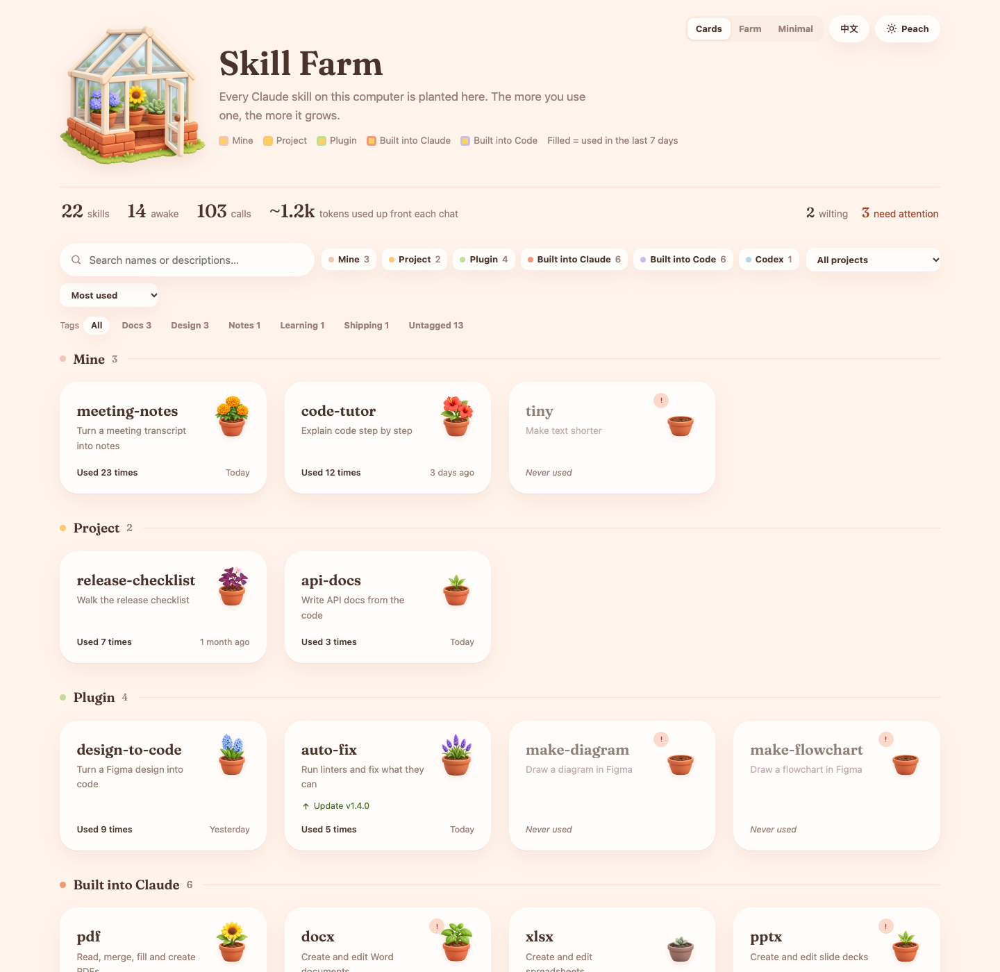
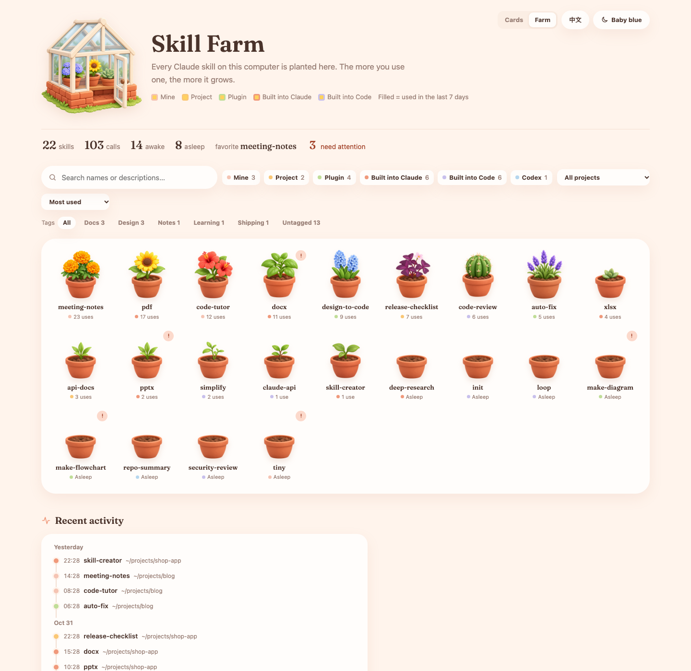
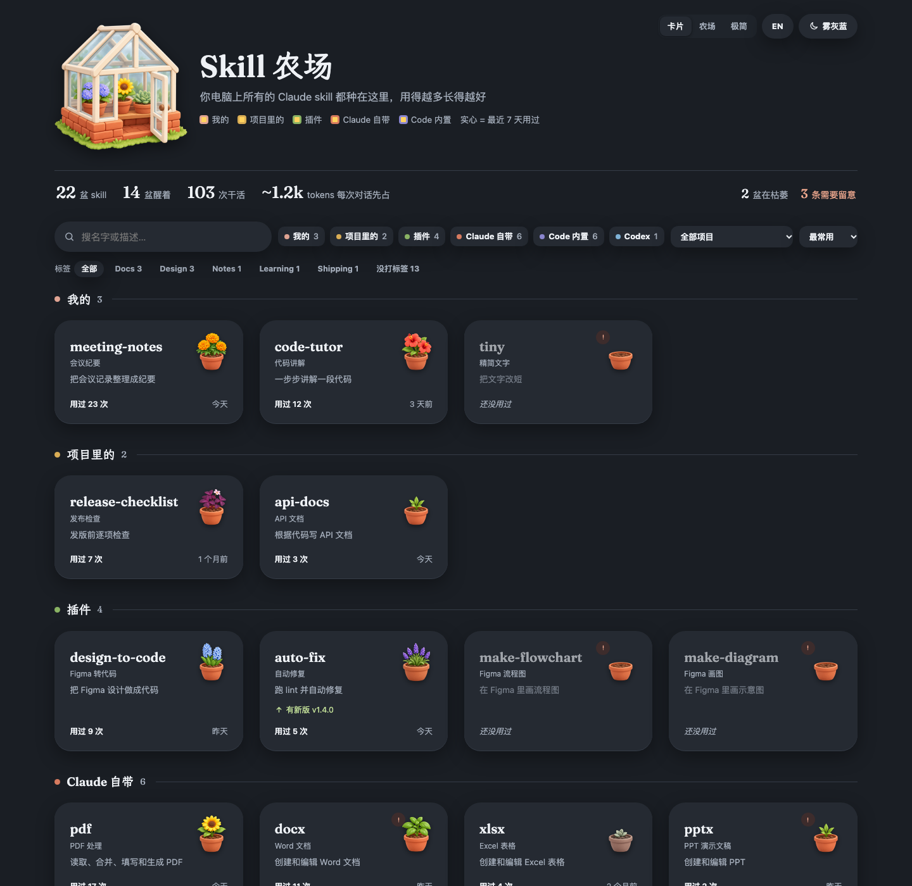
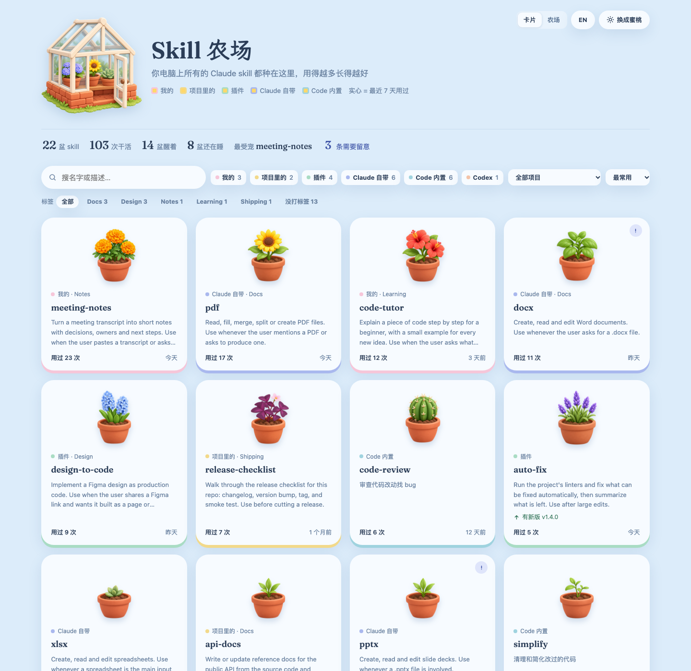

# Skill Farm

See every Claude Code skill on your computer as a potted plant. Skills you use grow, skills you never touch stay as seeded soil, skills you stopped using wilt, and skills that clash get flagged with a fix. It also tells you how many tokens your skill list takes up in every chat, and how much of that is dead weight.

Everything runs locally. One Python script reads your skill folders and your local Claude Code transcripts, then writes a single HTML page. Nothing is uploaded anywhere.

**[Live demo](https://shawn-dong.github.io/skill-farm/demo.html)** (made-up data) · [中文说明](#中文说明)







## Why

If you use Claude Code a lot, skills pile up in six different places: your own, project folders, plugins, the ones built into Claude, the ones bundled with Claude Code, and Codex. You rarely know which ones Claude actually reaches for, which ones never fire, and which ones have descriptions so similar that Claude may pick the wrong one.

Skill Farm answers four questions from your real usage:

- Which skills are working for me, and how often?
- Which ones have never been used, or stopped being used?
- What do they cost? Every chat starts with the names and descriptions of all your skills, so unused ones still take up context.
- Which ones need attention: similar descriptions, broken front matter, a newer version upstream, a skill that probably should have fired but didn't, or one you used before that is gone now?

## What you get

- **Every skill in one place, grouped by source.** Your own skills, project skills and plugin skills first; skills built into Claude, skills bundled with Claude Code, and Codex skills last. Each card shows the skill's name, a one-line intro and how often it was used.
- **Growth from real usage.** Counts come from your local transcripts in `~/.claude/projects`. A skill with no uses is seeded soil, 1 to 4 uses is a seedling, 5 or more is a mature plant, and a skill unused for 30 days after being used wilts. 40 plant kinds, so most skills get their own.
- **Check-up.** An estimate of the tokens your skill list adds to every chat, read from the list Claude Code actually injected, and the rarely used skills that take up most of it. Per skill: an 8-week trend, skills it is often used with, possible missed triggers and possible wrong triggers, each with short quotes from your own chats.
- **Problems with a fix.** A small mark on the card opens the problem and concrete steps to resolve it. You can ignore a warning you're fine with.
- **Delete one skill at a time.** The skill's detail view gives you the exact command: move your own skill's folder to the Trash, or uninstall the plugin a skill came from. Nothing is deleted for you.
- **Update hints.** Plugins with a newer version in their marketplace, and git-based skills that are behind their remote.
- **Filters.** By source, by the project a skill was used in, and by your own tags.
- **Recent activity.** A timeline of the last skill calls and where they happened.
- **Three views, three palettes, two languages.** Cards, farm or minimal; peach, baby blue or slate; Chinese or English, with Chinese display names for skills.

## Quick start

Requires Python 3.9 or newer. No packages to install.

```bash
git clone https://github.com/Shawn-Dong/skill-farm.git
cd skill-farm
python3 build.py --open
```

That writes `skill-board.html` next to the script and opens it. Run it again any time to refresh.

To look around without your own data first:

```bash
python3 build.py --demo --open
```

### Options

| Flag | What it does |
|---|---|
| `--open` | Open the page in your browser when done |
| `--fetch` | Fetch git remotes first so update hints are current. Slower, uses the network |
| `--reshuffle` | Reassign plants evenly across all plant kinds |
| `--demo` | Build `demo.html` from made-up data instead of yours |
| `--data-dir PATH` | Keep the page, `farm.json`, `tags.json` and thumbnails in another folder. The `SKILL_FARM_HOME` environment variable does the same |

The page also reads `?lang=en` or `?lang=zh`, `?view=cards`, `?view=farm` or `?view=mini`, and `?theme=peach`, `?theme=blue` or `?theme=slate` from the URL.

## Install as a Claude Code plugin

Skill Farm is also a Claude Code plugin, and this repo is its own plugin marketplace. Inside Claude Code, run:

```
/plugin marketplace add Shawn-Dong/skill-farm
/plugin install skill-farm@skill-farm
```

On Claude Code 2.1.275 or later one line does both: `/plugin install skill-farm --marketplace Shawn-Dong/skill-farm`. You still need Python 3.9 or newer as `python3`.

The plugin adds two things:

- **`/skill-farm:farm`** rebuilds the page and opens it. Add `demo`, `fetch` or `reshuffle` to do what the flags above do, for example `/skill-farm:farm fetch`.
- **A SessionEnd hook** that rebuilds the page in the background whenever a session ends, so it is fresh the next time you open it. It returns right away, prints nothing, skips the build if the page was rebuilt in the last minute, and gives up after two minutes. If a build fails, the error is in `last-build.log`.

The plugin code lives in a cache folder that Claude Code replaces on every update, so your own files go to `~/.claude/skill-farm/` instead: `skill-board.html`, `farm.json`, `tags.json`, `names.json`, `blurbs.json` and the thumbnails the page needs. Open `~/.claude/skill-farm/skill-board.html` any time. Set `SKILL_FARM_HOME` to use a different folder. Running `build.py` from a git clone keeps everything next to the script, as before.

## Make it yours

- **Tags.** Copy `tags.example.json` to `tags.json` and list tags per skill. Add English names under `_英文` if you write tags in Chinese. With the plugin, `/skill-farm:farm` tags new skills for you, reusing the tags you already have and never changing ones you set.
- **Chinese names.** `names.json` maps a skill's invoke name to the Chinese name shown in Chinese mode. Common built-in skills already have one; the plugin's `/skill-farm:farm` fills in new ones for you. `python3 build.py --unnamed` lists the skills still missing a name. `blurbs.json` holds the one-line intro shown on each card, in Chinese and English; skills without one show the first sentence of their description.
- **Plants.** `farm.json` remembers which plant each skill got. Change any entry to another file in `assets/plants`, or delete a line to have it reassigned. `growth` sets how many uses it takes to become a seedling and a mature plant.
- **More art.** Drop new transparent PNGs into `assets/plants`, add their sapling stage to `assets/growth-map.json`, and rebuild. Existing assignments stay put; new plants go to new skills first.

## How it works

`build.py` scans these places for `SKILL.md` files:

- `~/.claude/skills` for your own skills
- `.claude/skills` in every project folder that appears in your transcripts
- installed plugins listed in `~/.claude/plugins/installed_plugins.json`
- the skills that ship with the Claude desktop app, when found
- `~/.codex/skills`

Usage comes from the `Skill` tool calls recorded in `~/.claude/projects/**/*.jsonl`. Context cost comes from the `skill_listing` entries in the same transcripts, which hold the skill list Claude Code injected. The result is injected into `template.html` and saved as `skill-board.html`. Thumbnails are made with `sips` on macOS; on other systems the source images are used as they are.

## Privacy

- Your data never leaves your computer. The script makes no network calls unless you pass `--fetch`, which only runs `git fetch` on your own skill repos and plugin marketplaces.
- `skill-board.html`, `farm.json`, `tags.json`, `names.json` and `blurbs.json` contain your own data, and the page includes short quotes from your own chats in the check-up. They're in `.gitignore`. Don't commit or share them.
- The page loads two web fonts, LXGW WenKai from jsDelivr and Fraunces from Google Fonts. Without a network it falls back to system fonts.

## Limits

- The transcript format is not a public API. A Claude Code update may change it, and counts can break until the script is updated.
- Counts only include skills Claude called through the `Skill` tool or slash commands, not skills you read by hand.
- Token counts are estimates, not the real tokenizer. Missed and wrong triggers are hints from simple rules; read the quotes and decide yourself.
- Tested on macOS. Linux and Windows should work, but the desktop app skill folder is only looked up on macOS.

## Credits

- Plant, growth and greenhouse images were generated with an AI image model for this project and are released with it under the MIT license.
- Fonts: [LXGW WenKai](https://github.com/lxgw/LxgwWenKai) and [Fraunces](https://github.com/undercasetype/Fraunces), both under the SIL Open Font License.

This is an independent project. It is not made by or affiliated with Anthropic.

## License

MIT

---

## 中文说明

把电脑上所有的 Claude Code skill 种成一盆盆植物。用得越多长得越好，从没用过的就是一盆刚播种的土，很久没用的会枯萎，描述打架或者格式有问题的会标出来，并告诉你怎么改。它还会告诉你，所有 skill 的清单每次对话要先占掉多少 token，其中多少是白占的。

全部在本机运行。一个 Python 脚本读取 skill 文件夹和本地的 Claude Code 对话记录，生成一个 HTML 页面，不上传任何东西。

在线演示（示例数据）：https://shawn-dong.github.io/skill-farm/demo.html?lang=zh




**它回答四个问题**

- 哪些 skill 真的在替我干活，各用了几次？
- 哪些从来没被用过，或者早就不用了？
- 它们占多少：每次对话都会先放进所有 skill 的名字和描述，没用的也一直占着位置。
- 哪些需要处理：描述太像、格式有问题、上游有新版、该用却可能没被调用、以前用过但现在找不到了？

**还有这些**

- 按来源分组：你自己的、项目里的、插件的在前，Claude 自带、Code 内置和 Codex 的在最后。
- 每张卡片是名字、中文名、一句话介绍和用了几次。
- 体检：上下文占用、近 8 周趋势、常一起用的 skill、可能漏触发和可能误触发，附上你对话里的原话。
- 单个删除：详情里给出具体命令，把你自己的 skill 移到废纸篓，或卸载它所在的插件，不会替你自动删。
- 卡片、农场、极简三种视图，蜜桃、天蓝、雾灰蓝三套配色，中英文切换。

**开始用**

需要 Python 3.9 或更新版本，不用装任何包。

```bash
git clone https://github.com/Shawn-Dong/skill-farm.git
cd skill-farm
python3 build.py --open
```

想先看看效果，可以用示例数据：

```bash
python3 build.py --demo --open
```

**作为 Claude Code 插件安装**

这个仓库本身就是一个插件市场。在 Claude Code 里运行：

```
/plugin marketplace add Shawn-Dong/skill-farm
/plugin install skill-farm@skill-farm
```

Claude Code 2.1.275 及以上可以一行装好：`/plugin install skill-farm --marketplace Shawn-Dong/skill-farm`。电脑上仍然需要 Python 3.9 或更新版本。

装好以后：

- 运行 `/skill-farm:farm` 重新生成页面并打开。后面可以加 `demo`、`fetch` 或 `reshuffle`，作用和上面的同名参数一样。
- 每次会话结束时，插件会在后台悄悄重新生成页面，不会拖慢退出，也不输出任何东西；一分钟内刚生成过就跳过。出错时看 `last-build.log`。

插件代码放在 Claude Code 的缓存目录里，每次更新都会被替换，所以你自己的文件放在 `~/.claude/skill-farm/`：`skill-board.html`、`farm.json`、`tags.json`、`names.json`、`blurbs.json` 和页面要用的缩略图。想换位置就设置环境变量 `SKILL_FARM_HOME`。从 git clone 直接运行 `build.py` 的话，文件还是放在脚本旁边，和以前一样。

**自定义**

- 标签：把 `tags.example.json` 复制成 `tags.json`，按 skill 写标签。用插件的话，`/skill-farm:farm` 会自动给新 skill 打标签，优先沿用你已有的标签，不会改动你手动打的。
- 中文名和一句话介绍：`names.json` 是中文名对照表，`blurbs.json` 是卡片上的中英文一句话介绍。常见的内置 skill 已经自带，插件的 `/skill-farm:farm` 会自动给新 skill 补上。
- 盆栽：`farm.json` 记着每个 skill 种的是哪盆，可以手动改；`growth` 设置长成幼苗和成熟各需要用几次。
- 新素材：把透明背景的 PNG 放进 `assets/plants`，在 `assets/growth-map.json` 里写上对应的幼苗图，重新运行即可。

**隐私**

`skill-board.html`、`farm.json`、`tags.json`、`names.json`、`blurbs.json` 里是你自己的数据，页面的体检部分还会引用你对话里的原话。它们都已写进 `.gitignore`，不要提交或分享。token 数是估算，漏触发和误触发只是按简单规则给的提示，请看原话自己判断。只有加了 `--fetch` 才会联网，而且只是对你自己的 skill 仓库和插件市场运行 `git fetch`。

本项目是个人作品，不是 Anthropic 官方出品，与 Anthropic 没有关联。
